# Office Tracker user guide

Office Tracker records when you arrive, take breaks and leave, and tells you live whether today
meets the office rules. This guide covers **version 1.10**. Your version is shown at the bottom of
**Settings**.

The screenshots come from the real app running on an Android emulator with demo data, with the
clock set to Wednesday 21 October 2026, 2:20 PM. Colors on your phone follow your wallpaper
(Android 12 and later), so they may look different.

**Contents**

1. [Installing and updating](#1-installing-and-updating)
2. [The office rules the app checks](#2-the-office-rules-the-app-checks)
3. [Today: logging in, breaks and logging out](#3-today-logging-in-breaks-and-logging-out)
4. [The clock dial and the numbers under it](#4-the-clock-dial-and-the-numbers-under-it)
5. [Day types: Office, WFH, Half day, Short leave, Holiday, On leave, Weekly off](#5-day-types)
6. [LOP days and Regularize](#6-lop-days-and-regularize)
7. [Fixing entries: add, edit, Edit day, change log, warnings, forgotten logout](#7-fixing-entries)
8. [Other days and planning leave](#8-other-days-and-planning-leave)
9. [History: calendar, charts, week, month and year](#9-history)
10. [Sharing a report or a PDF month sheet](#10-sharing-a-report)
11. [Notifications and reminders](#11-notifications-and-reminders)
12. [Home-screen widget and quick settings tile](#12-home-screen-widget-and-quick-settings-tile)
13. [Settings](#13-settings)
14. [Backup, restore and Clear data](#14-backup-restore-and-clear-data)
15. [Questions](#15-questions)

---

## 1. Installing and updating

1. On your phone, open the [Releases page](https://github.com/gkgsiva/tracker/releases).
2. Under the newest version, tap **office-tracker-&lt;version&gt;.apk**.
3. Open the downloaded file and tap **Install**. The first time, Android asks you to allow installs
   from your browser or Files app; allow it once.
4. Open the app. On Android 13 and later it asks once for permission to send notifications. Allow it,
   or the reminders and the live notification can't appear.

**Updating:** install the newer APK the same way. From version 1.2 on, every build is signed with the
same key, so it installs over the old one and keeps your data.

Everything stays on your phone. There is no account, nothing is sent anywhere, and the app doesn't use your location.

## 2. The office rules the app checks

| Rule | Default | What happens if you break it |
| --- | --- | --- |
| Log in by (core start) | 9:00 AM | The day is **LOP** as soon as you log in late |
| Leave after (core end) | 5:00 PM | Logging out before this makes the day **LOP** |
| Hours inside | 8h | Finishing the day with less than 8h inside makes it **LOP** |
| Official hours | 8:30 AM to 5:30 PM | Sets your break allowance (below); never LOP by itself |

Breaking **any one** of the first three rules makes the day LOP (loss of pay), even if you were
inside for more than 8 hours.

**Break allowance.** Your break for the day is the time from your login to 5:30 PM, minus 8 hours:

- Log in at 8:30 AM: 9h until 5:30 PM, minus 8h, gives **1h** of break.
- Log in at 8:00 AM: **1h 30m** of break.
- Log in at 8:45 AM: **45m** of break.

Taking a longer break is **not** LOP. It only means you have to stay later to reach 8 hours inside.
Before you log in, the app shows the allowance for an 8:30 login.

**Each day stands on its own.** Every working day needs its own 8 hours inside. Extra time on one
day never makes up for a short day, so the app never shows an average you need to catch up to.

**Half days and short leave** have their own, lighter rules; see [Day types](#5-day-types).

All of these values can be changed in [Settings](#13-settings).

## 3. Today: logging in, breaks and logging out

The app has three tabs at the bottom: **Today**, **History** and **Settings**. Today is where you
tap in and out.

| Inside the office | On a break |
| --- | --- |
| 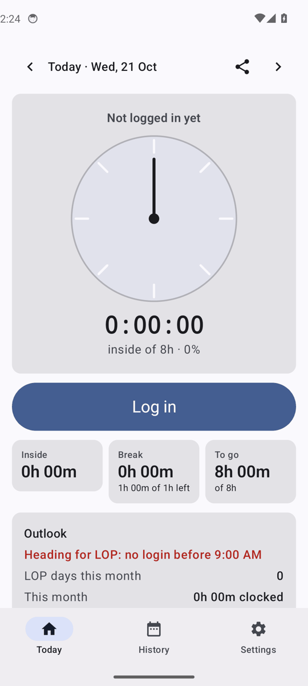 | 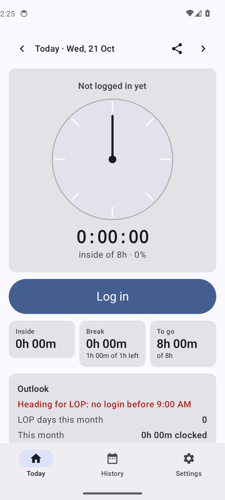 |

The big button changes with where you are in the day:

| You are... | Buttons you see |
| --- | --- |
| Not logged in yet | **Log in** |
| Inside the office | **Start break** and **Log out** |
| On a break | **End break**, plus **I've left for the day** |
| Logged out | **Log in again** (if you come back) |
| On a weekly off day | **Log in anyway** (turns the day into a working day) |

- **Log in** when you arrive. The time is recorded to the second.
- **Start break** when you step out. The app asks how long the break will be: 5, 10, 15, 20, 30 or
  45 minutes, 1 hour, or **No limit**. Your last choice is selected, so usually you just tap
  **Start break** again. Tap **End break** when you are back. You can take as many breaks as you like;
  they are all added up.
- During a planned break, Today shows "12m left of your 15m break" and the time you planned to be back.
  Tap **Change** to make the break longer or shorter. If you picked No limit, **Set a length for this
  break** adds one. You get an alert a couple of minutes before the planned break ends, and again when it
  does (see [Notifications](#11-notifications-and-reminders)).
- **Log out** when you leave for the day. If logging out now would make the day LOP, because it's
  before 5:00 PM or you haven't done 8 hours yet, the app warns you first and says why. Tap **Log out**
  to go ahead anyway, or **Cancel**.
- **I've left for the day** (shown during a break) turns the break you are on into your logout, for
  when you went on a break and didn't come back.

| Choosing the break length | Warning before an early logout |
| --- | --- |
| 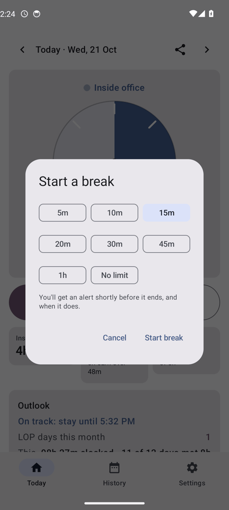 | 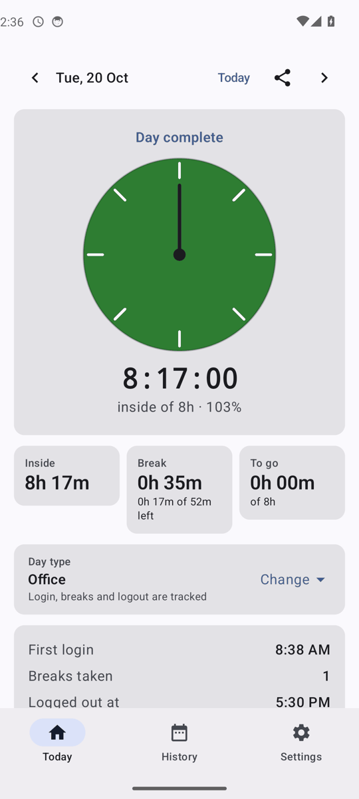 |

You don't have to open the app for these. The [notification](#11-notifications-and-reminders),
the [widget](#12-home-screen-widget-and-quick-settings-tile) and the
[quick settings tile](#12-home-screen-widget-and-quick-settings-tile) have the same buttons. A break
started from one of those uses the length you chose last time.

## 4. The clock dial and the numbers under it

At the top of Today:

- **Status** in color: *Not logged in yet*, *Inside office* (with a pulsing dot), *On break*,
  *Day complete* or *Logged out · LOP*.
- **Clock dial**: fills up toward the hours the day needs (8h, or less on a half day or short leave). It is the primary color while you are inside, amber on a
  break, green once you reach 8h, and red if the finished day is LOP.
- **Time inside** as a live counter (for example `4:48:12`), with "inside of 8h · 60%". On a break the
  total break time ticks below it.

Scroll down for the details:

- **Inside / Break / To go** tiles: time inside so far, break used with how much of the allowance is
  left (or how far over you are), and how much more you need to reach 8h.
- **Outlook**: a one-line forecast for today, such as "On track: stay until 5:38 PM", "Log in by
  9:00 AM (25m left) to avoid LOP" or "LOP today: late login". Below it: LOP days this month, hours
  clocked this month, how many finished days met 8h, and working days left.
- **Day type** (see the next section).
- **Details**: first login (red if after 9:00 AM), breaks taken, **Back by** (during a break: the time to
  be back so you can still leave by 5:30 PM), **You can leave at** (the later of "8h reached" and 5:00 PM),
  and the logout time once you've left.
- **Entries**: every login, break start, break end and logout for the day, each with edit and delete
  buttons.

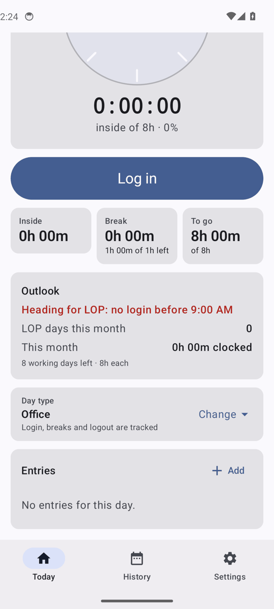

## 5. Day types

Each day has a type. Tap the **Day type** row and pick one; each choice says what it means.

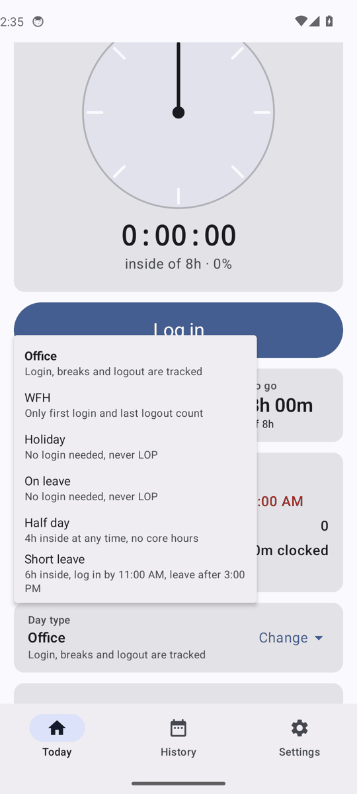

| Type | What it means |
| --- | --- |
| **Office** (default) | Login, breaks and logout are tracked. All rules apply. |
| **WFH** | Work from home. Only your first login and last logout count, there are no breaks, and the same LOP rules apply (log in by 9, leave after 5, 8h worked). |
| **Half day** | 4 hours inside, at any time of day. There are no core hours, so no late-login or early-exit LOP; it is LOP only if you finish with less than 4h. |
| **Short leave** | 2 hours off at the start or end of the day: 6 hours inside, log in by 11:00 AM, leave after 3:00 PM. |
| **Holiday** | No login needed, never LOP. |
| **On leave** | No login needed, never LOP. Counted in your leave total for the year. |
| **Weekly off** | Set automatically for your weekly off days (Saturday and Sunday unless you change them). No login needed. If you work that day, tap **Log in anyway** or choose Office. |

On a half day or short leave the break allowance stays what an on-time login gives (1h by default),
whenever you log in. The 4h and 2h amounts can be changed in [Settings](#13-settings).

| WFH | Half day | Short leave |
| --- | --- | --- |
| 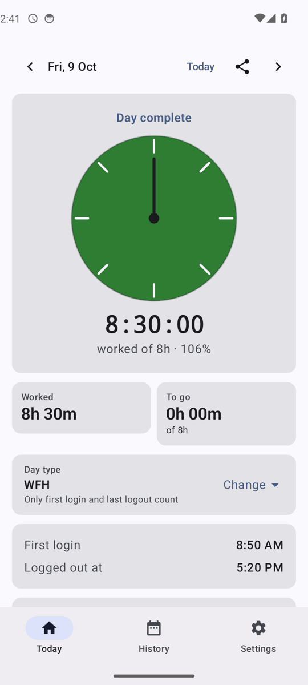 |  |  |

History and the reports count WFH, holiday, leave, half days and short leave separately.

## 6. LOP days and Regularize

When a day breaks a rule, Today shows a red **LOP day** card listing each reason, for example
"Logged in at 9:12 AM, after 9:00 AM". A late login shows as LOP straight away; leaving early or short
hours show once the day is over.

| An LOP day | Regularize dialog |
| --- | --- |
| 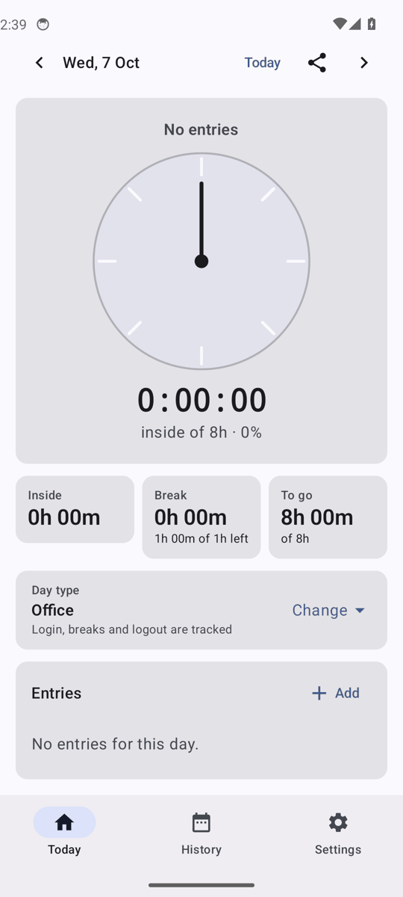 | 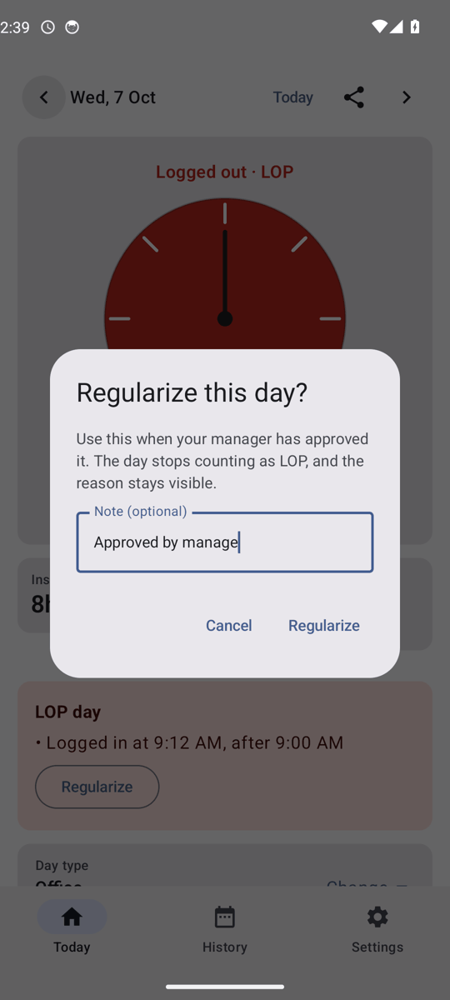 |

If your manager approves the day, tap **Regularize**, add an optional note (such as "Approved by
manager") and tap **Regularize** again. The day then:

- shows **Regularized** instead of LOP, keeps the original reasons and your note,
- is not counted as LOP anywhere (Today, History, reports, month summary),
- is marked in its own color on the History calendar.

Changed your mind? Tap **Undo regularize** on that day. History keeps a list of every regularized day
(see [History](#9-history)).

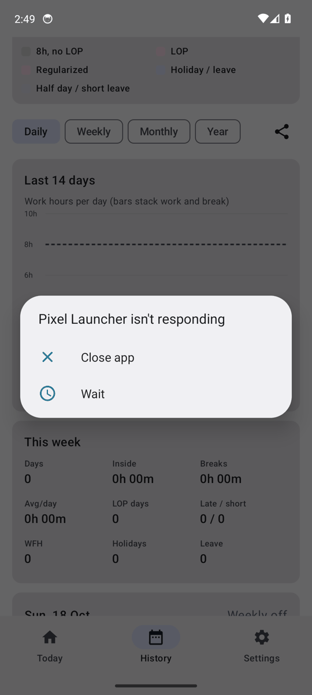

## 7. Fixing entries

Forgot to tap, or tapped at the wrong time? Every entry can be fixed, on any day.

- **Add**: in the Entries card tap **Add**, choose **In** (login or break end), **Break start** or
  **Logout**, set the time and tap **Save**.
- **Edit**: tap the pencil next to an entry to change its time or kind.
- **Delete**: tap the bin next to an entry, then **Delete**.

**Edit day** (next to Add, once the day has entries) shows the whole day in one form: login, each break
as start and end, and logout. Tap any time to change it, **Add break** to add one, or ✕ to remove a break
or the logout. Add a reason if you like (for example "forgot to log the break") and tap **Save**. If the
times don't line up, such as a break that ends before it starts, the form says what's wrong and Save
stays off until it's fixed.

**Changes.** Every change you make by hand, in Edit day or entry by entry, is written to a **Changes**
list at the bottom of that day, newest first, for example "Login 9:05 AM → 8:55 AM" with when you made it
and your reason. It is part of the backup.

| Edit day | Changes list |
| --- | --- |
| 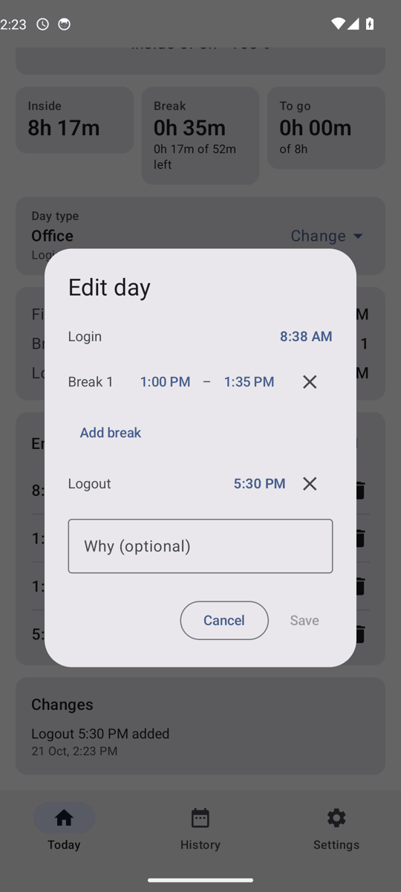 | 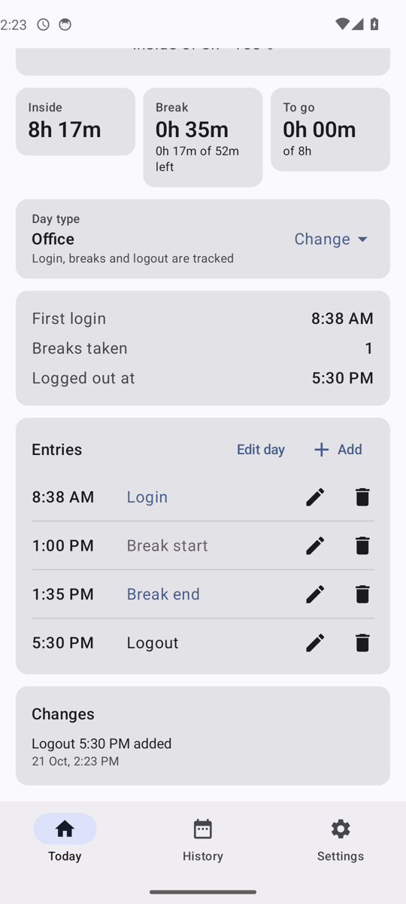 |

**Forgotten logout.** If a working day in the last week has a login but no logout, Today shows
**No logout on &lt;day&gt;** at the top. Tap **Add logout**: the app opens that day with the add dialog
ready (set to Logout at 5:30 PM). Change the time to when you actually left and tap **Save**. The
morning login reminder also mentions a missing logout.

**Entries that don't fit together** are flagged on the day in a **Check these entries** card, and are
left out of the hours until you fix them:

| Warning | Fix |
| --- | --- |
| Break started at ... never ended. Was it your logout? (a past day ending on a break) | **Mark as logout** turns it into the logout in one tap |
| Check-out at ... comes before the first login | **Edit** |
| Login at ... follows another login with no break between | **Edit** |
| Check-out at ... follows another check-out | **Edit** |

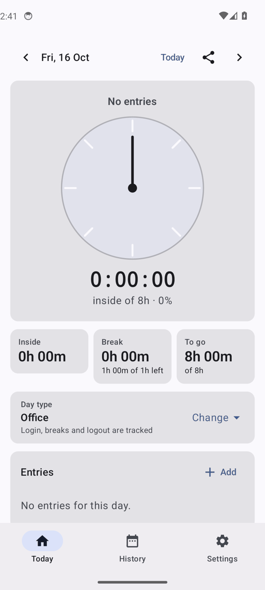

## 8. Other days and planning leave

At the top of Today:

- **‹ and ›** move one day back or forward.
- **Tap the date** to open a calendar and jump to any day, past or future.
- **Today** (shown when you are on another day) brings you back.

To plan leave, a holiday, a half day or short leave, either **long-press the day on the History
calendar** and pick the type, or go to the date on Today and change its **Day type**. Future days show as **Upcoming** or **Planned day off**, and planned days are listed in
History under **Leave & holidays**.

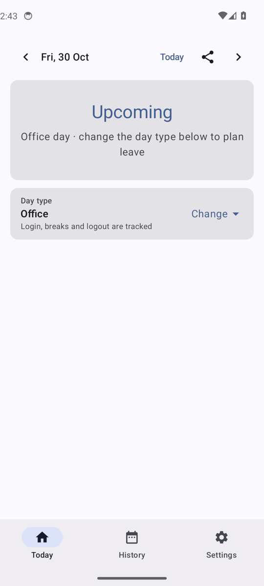

## 9. History

History opens with a **month calendar**. Use ‹ and › to change month, tap any day to open it on Today,
and **long-press** a day to set its type (Office, WFH, Holiday, On leave, Half day, Short leave), for
example to plan leave ahead.

| Calendar | Long-press to set a day type |
| --- | --- |
|  | 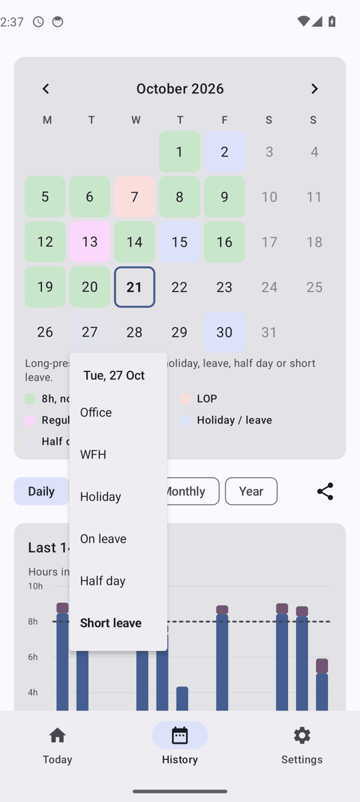 |

| Color | Meaning |
| --- | --- |
| Green | 8h met, no LOP |
| Red | LOP |
| Regularized color (tertiary) | Regularized |
| Holiday / leave color (secondary) | Holiday or on leave |
| Grey | Half day or short leave (until it's finished) |
| Outlined in your theme color | Today |
| Red outline | A day with no logout |
| Faded number | Weekly off |

Below the calendar, choose **Daily**, **Weekly**, **Monthly** or **Year**:

- **Daily**: a bar chart of the last 14 days (inside time, break time, LOP days in red, and the 8h
  target line), this week's totals, and a list of each day with times, break and any LOP reason.
- **Weekly**: the last 8 weeks. **Monthly**: the last 6 months. Each bar is the average inside time per
  working day in that period, shown as a record of how it went. Below are the totals (days, inside,
  breaks, LOP days, late logins and short days, WFH, holidays, leave) and one line per period.

- **Year**: one row per month of the year with days that **Met** the hours, **LOP**, **Reg.**
  (regularized), **Leave**, **Hol.** (holidays) and **½ / SL** (half days and short leave), a total row,
  and total hours inside for the year. Use ‹ and › to change year.

| Daily | Weekly |
| --- | --- |
| 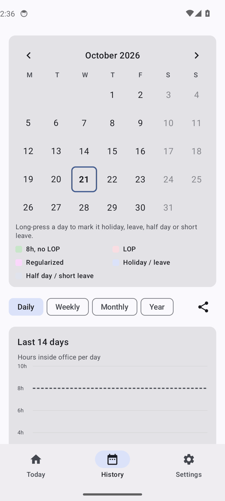 | 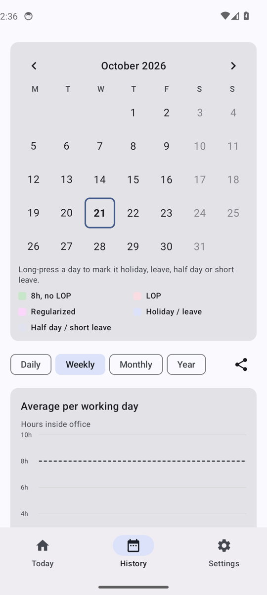 |

| Monthly | Year |
| --- | --- |
| 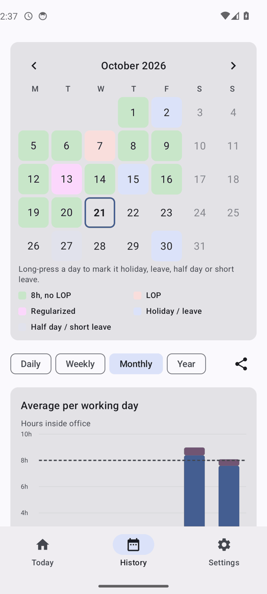 | 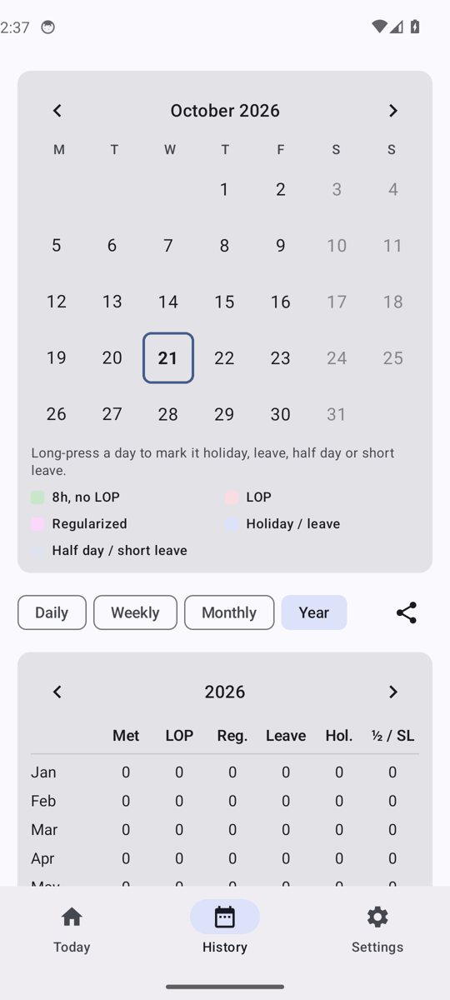 |

**This week and month** shows hours clocked, how many finished days met 8h, how many fell short,
working days left (8h each) and LOP days. It does not average hours across days: each day needs its own
8 hours. Planned leave, holidays and weekly offs aren't counted as working days.

**Leave & holidays** shows leave taken and planned this year, and lists upcoming holidays and leave.

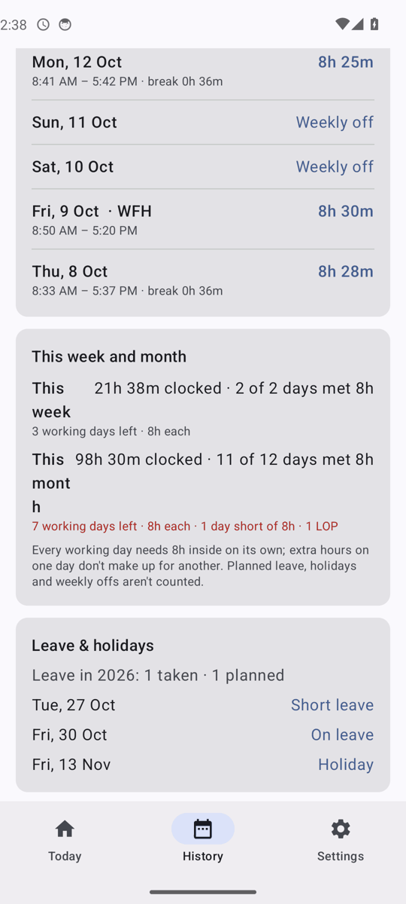

**Regularized** lists every regularized day, newest first: what the LOP was, your note, and the date
you regularized it. Tap its share icon to send the whole list, for example to HR.

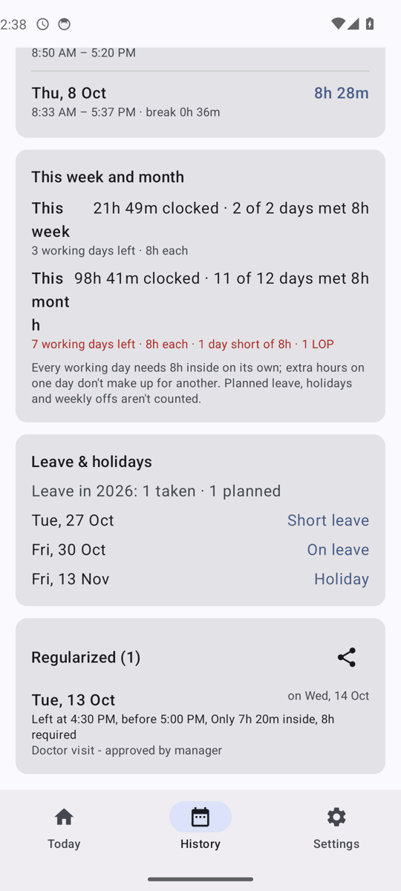

## 10. Sharing a report

Tap the **share** icon to send a plain-text report through WhatsApp, email or any other app.

- On **Today**, it shares the day you're looking at: login, logout, time inside, breaks, what's left
  and the status (OK, LOP with reasons, or Regularized with the note).
- On **History**, choose **Today**, **This week** or **This month**: totals plus one line per day.
- On **History** you can also choose **This month as PDF** or **Last month as PDF**: a one-page A4 sheet
  with every day's type, login, logout, breaks, hours inside and status, plus the month's totals. Send it
  to your manager or HR, or save it.

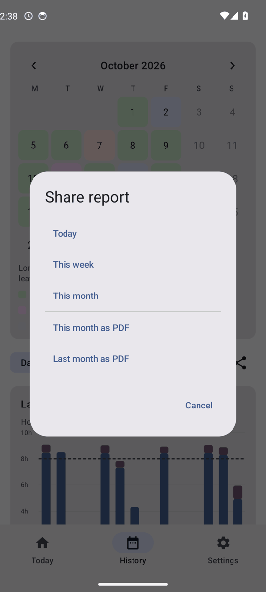

## 11. Notifications and reminders

**Live status notification.** While you're logged in, a quiet notification shows a countdown to 8h
(or "8h done"), your leave time and break used. On a break it counts up your break time and says when
to be back (and your planned break length). It shows on the lock screen, even on phones that hide quiet
notifications there, so you can check the time left without unlocking. Its **Start break**, **End
break** and **Log out** buttons work from the lock screen without opening the app.

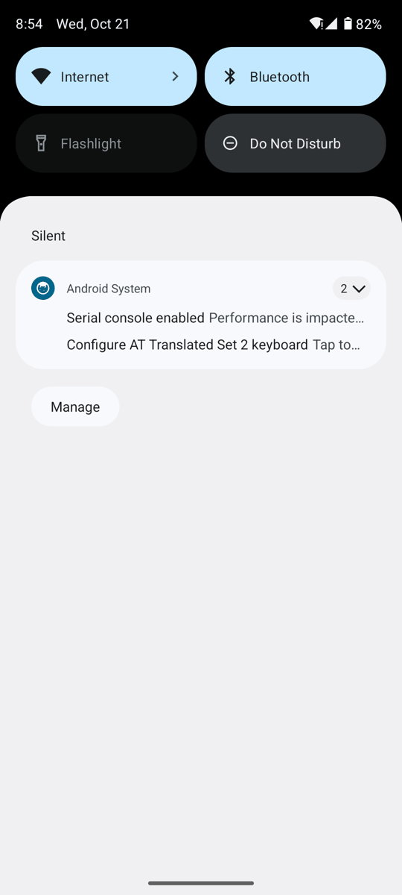

**Reminders** (each can be turned off in Settings):

| Reminder | When |
| --- | --- |
| Log in reminder | 15 minutes before 9:00 AM on working days, if you haven't logged in. Also mentions a recent day with no logout. |
| Time to leave | When you've done 8h and it's after 5:00 PM: "You can leave now. Remember to log out." |
| Long break | 5 minutes before your break allowance runs out, and again when it does |
| Planned break ending | A pop-up alert with an **End break** button, 2 minutes (adjustable) before the break length you picked runs out, and again when it does |
| Month summary | On the 1st at 10:00 AM: for the month just ended, days that met 8h, LOP days, regularized days and total hours |

| Planned break ending | Month summary |
| --- | --- |
| 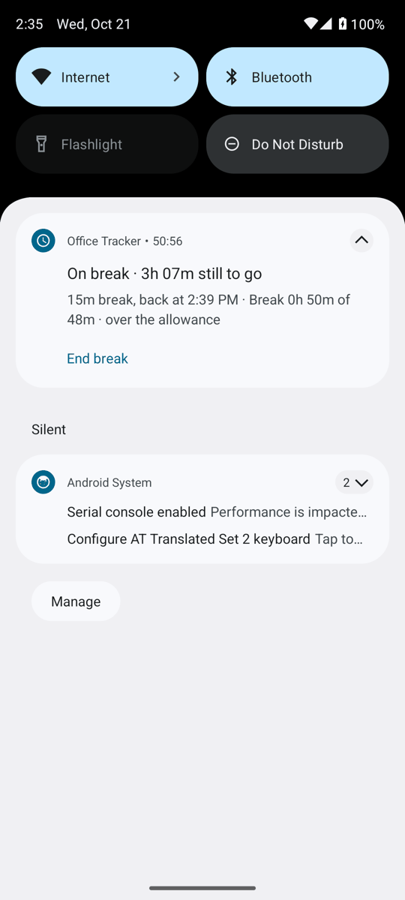 | 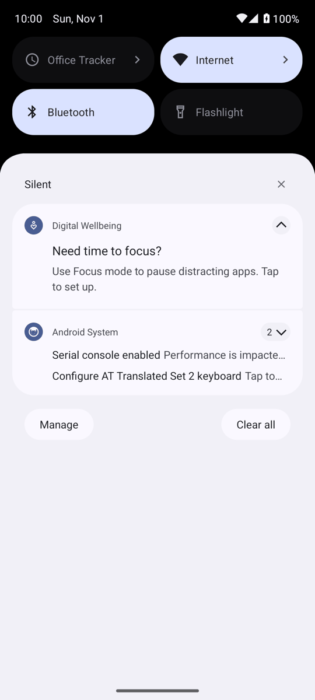 |

The reminders are a few one-off alarms. The app does no other work in the background, so it doesn't
drain the battery.

## 12. Home-screen widget and quick settings tile

**Widget.** Long-press your home screen, tap **Widgets**, find **Office Tracker** and drag it onto the
screen. It shows your status, a live inside-time counter, your leave time, and one-tap buttons:
**Log in**, **Start break** / **Log out**, or **End break**, depending on the moment. On a break it
counts your break time for the day and shows when you're due back. Its counters are drawn by the
phone itself, so they stay right without the app open. Tap the widget itself to open the app.

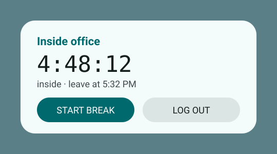

*(The widget picture is a drawing of the real layout; the emulator can't place widgets on its home
screen automatically.)*

**Quick settings tile.** Pull down the quick settings panel, tap the pencil (edit), and drag the
**Office break** tile into your tiles. One tap logs you in, starts a break or ends a break, also from
the lock screen. It is highlighted while you're on a break, and greyed out when there is nothing to do
(for example after logging out).

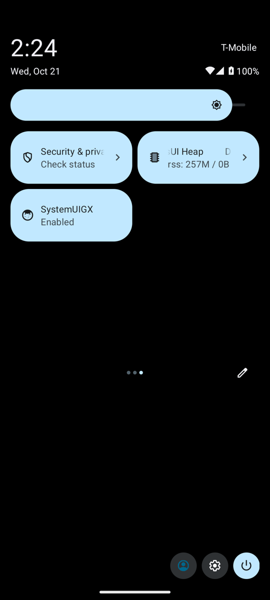

## 13. Settings

- **Office rules**: tap **Log in by** or **Leave after** to change the core hours, use **−** and **+** to
  change **Hours inside** (in 30-minute steps), and tap **Official start** or **Official end** to
  change the official hours that set your break allowance.
- **Half day and short leave**: hours needed on a half day (4h by default) and how much time short leave
  gives you (2h by default). The line below shows what that means, for example "6h inside, and can log
  in by 11:00 AM or leave after 3:00 PM".
- **Appearance**: **System** (follows the phone's dark mode), **Light** or **Dark**.
- **Weekly off days**: tap the days you don't work. Saturday and Sunday are selected by default.
- **Reminders**: switches for Log in reminder, Time to leave, Long break, Month summary and the live
  Status notification, and **Planned break alert** (how many minutes before a planned break ends you
  get the alert, 1 to 10).
- **Backup**: see the next section.
- At the bottom: the app version, and tips for the widget and tile.

| Half day and short leave | Reminders | Dark theme |
| --- | --- | --- |
| 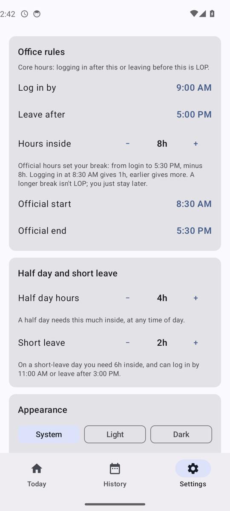 | 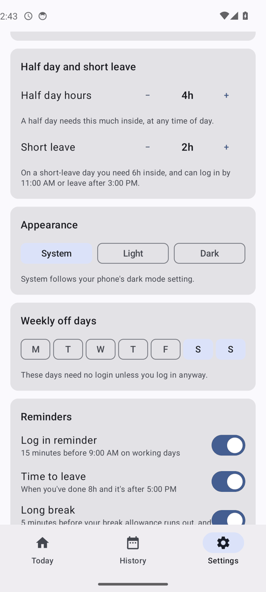 | 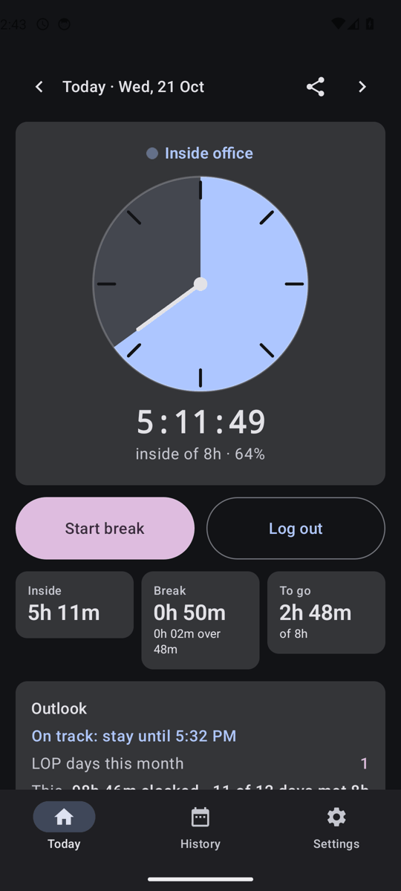 |

## 14. Backup, restore and Clear data

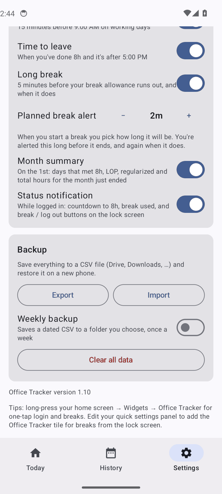

- **Export** saves everything (all entries, day types, regularized days and the Changes lists) to a CSV file. Save it to
  Google Drive, Downloads or anywhere you like.
- **Import** restores a CSV backup. It **replaces** all current data, so the app asks first.
  Use Export on the old phone and Import on the new one to move phones.
- **Weekly backup**: turn it on and pick a folder (a Drive folder works). The app saves a dated file such
  as `office-tracker-2026-10-21.csv` there right away and then once a week. The switch shows the folder
  and the date of the last backup.
- **Clear all data** deletes every login, break, logout and day type. The app asks first, and keeps a
  copy on the phone: right after clearing, tap **Undo** next to "All data deleted." to bring everything
  back.

| Confirm | Undo |
| --- | --- |
| 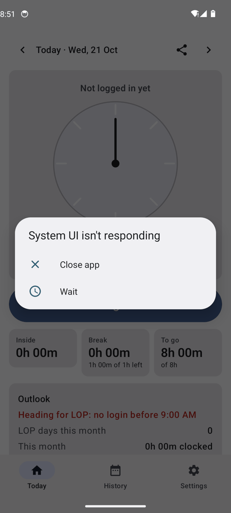 | 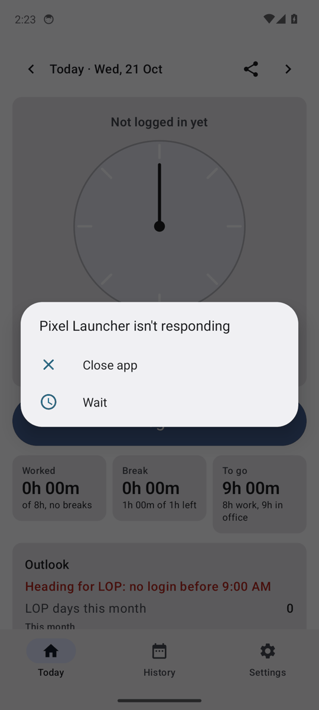 |

Your settings (rules, theme, reminders) are not part of the backup and are not cleared.

## 15. Questions

**I worked 9 hours but the day is LOP. Why?** Check the LOP card on that day. A login after 9:00 AM or
a logout before 5:00 PM makes the day LOP whatever the hours.

**I took a 1h 20m break. Is that LOP?** No. A long break is never LOP by itself. You just need to stay
later to reach 8h inside, and "You can leave at" moves accordingly.

**I did 9 hours yesterday. Can I do 7 today?** No. Each day needs its own 8 hours; extra time doesn't
carry over.

**I forgot to tap Log in this morning.** Go to Today, tap **Add** in Entries, choose **In** and set
the time you arrived. To fix several times at once, use **Edit day**.

**I have a doctor's appointment in the morning.** Set the day to **Short leave** (long-press it on the
History calendar). You then have until 11:00 AM to log in and need 6 hours inside.

**The app says "Missing logout" for a day.** Tap **Add logout** on the prompt (or open the day and add a
Logout entry) with the time you left.

**I'm getting a new phone.** Settings → Backup → **Export**, copy the file to the new phone (or save it
to Drive), install the app there and use **Import**.

**The notification or reminders don't appear.** Check that notifications are allowed for Office
Tracker in your phone's settings, and that the switches under Settings → Reminders are on.
